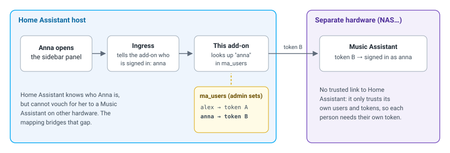
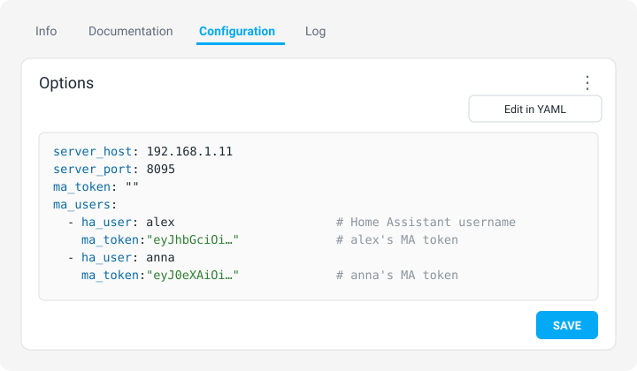

# Home Assistant Apps

> **Part of the [Home Audio Stack](https://github.com/shuricksumy/home-audio-stack)** — Music Assistant → Snapcast → PipeWire, into USB DACs, Bluetooth speakers and LED strips. That page maps how these projects fit together.

[](https://github.com/shuricksumy/home-assistant-apps/actions/workflows/lint.yaml)
[](LICENSE)

Home Assistant's Ingress only serves **add-ons**. So anything worth giving its
own hardware — a music server on a box wired to your DAC, a camera analyser on a
machine with a GPU — loses its place in the sidebar the moment you move it off
the Home Assistant host.

These add-ons put it back. Each one is a small proxy: the service keeps running
where it belongs, and Home Assistant shows it with its own login in front,
working from outside over Nabu Casa like anything else. Nothing is exposed to the
internet.

**Setting up the audio side too?** The [Home Audio Stack](https://github.com/shuricksumy/home-audio-stack) has a [complete compose file](https://github.com/shuricksumy/home-audio-stack/tree/main/examples) for the services these add-ons surface.

## Adding this repository

[](https://my.home-assistant.io/redirect/supervisor_add_addon_repository/?repository_url=https%3A%2F%2Fgithub.com%2Fshuricksumy%2Fhome-assistant-apps)

Or by hand: **Settings → Add-ons → Add-on Store → ⋮ → Repositories**, then add

```
https://github.com/shuricksumy/home-assistant-apps
```

Requires Home Assistant OS or Supervised. Home Assistant Container has no add-on
store.

## Add-ons

| | Add-on | What it gives you |
| :---: | ------ | ----------------- |
|  | **[Music Assistant Proxy](music_assistant_proxy)** | Music Assistant running on its own hardware, in your Home Assistant sidebar |
|  | **[Frigate Yard Stats Proxy](frigate_yard_stats_proxy)** | Frigate yard activity and vehicle reports, in your Home Assistant sidebar |
|  | **[Bluetooth Web Snapclient Proxy](bluetooth_web_proxy)** | Pair Bluetooth speakers and run Snapcast players on another machine, in your Home Assistant sidebar |

They all solve the same problem: a service worth giving its own hardware loses its
place in the sidebar, because Ingress only serves add-ons. These put it back —
without exposing the service itself to anything but your network.

### Music Assistant Proxy

Music Assistant's own add-on runs the server on your Home Assistant machine. If you
would rather run it on dedicated hardware — a NAS, a mini PC, anything with the
headroom for library scans and transcoding — you lose the sidebar panel, because
Ingress only serves add-ons.

This add-on is an nginx reverse proxy that gives it back. It does **not** run Music
Assistant; it puts a server running elsewhere behind Home Assistant's Ingress, so the
panel appears in the sidebar and is reachable wherever Home Assistant is, without
exposing Music Assistant itself.

It also works around a quirk of the current Music Assistant release, which decides it
is running as an add-on purely from the URL and then refuses to show a login form.
[The add-on docs](music_assistant_proxy/DOCS.md) explain what is rewritten and why,
how signing in works, and what to expect when Music Assistant updates.

#### Several people, each with their own Music Assistant account

The panel shows for every Home Assistant user, admins and standard users alike. What it
cannot do on its own is sign each person into *their* Music Assistant account.

**Why a manual mapping is needed.** When Music Assistant runs as an add-on on the Home
Assistant machine, it trusts Home Assistant to say who is signed in, so everyone lands in
their own account automatically. That trust only exists on Home Assistant's internal
network; Music Assistant checks it at the connection level, not just from a header. A
server on its own hardware has no such link: it only trusts its own users and tokens.
Home Assistant does still tell this add-on who opened the panel, so the add-on can hand
Music Assistant the right token, but someone has to tell it which token belongs to whom.



You have two options:

- **Each person signs in once.** Leave the token options empty. Each person opens the
  panel and signs in with their Music Assistant account. The session is kept per browser
  for 30 days and renews while it is used.
- **Map Home Assistant users to Music Assistant tokens.** Nobody has to sign in. Set it up
  as below.

**Setting up the mapping**

1. **Create a token for each person in Music Assistant.** Sign in to Music Assistant *as
   that person*, open the profile settings, create a **long-lived token**, and copy it.
   The token decides which Music Assistant account they get, so it must come from their
   own account.
2. **Find each person's Home Assistant username.** It is the name typed at the login
   screen, not the display name. With Advanced Mode on in your profile, it is shown under
   **Settings → People → Users**. Case does not matter.
3. **Add the mapping to the add-on.** Open **Settings → Add-ons → Music Assistant Proxy →
   Configuration**, choose **⋮ → Edit in YAML**, and add an `ma_users` list:

   ```yaml
   ma_users:
     - ha_user: alex
       ma_token: "<alex's long-lived token>"
     - ha_user: anna
       ma_token: "<anna's long-lived token>"
   ```

   

   Only Home Assistant admins can open this tab, so the list of tokens is not visible to
   anyone else.
4. **Save and restart the add-on,** then open the **Log** tab. Every entry is checked
   against Music Assistant:

   ```
   ma_users: alex: token accepted (Music Assistant user "alex")
   ma_users: anna: Music Assistant rejected the token (HTTP 401).
   ```

   A rejected token, a misspelt username or a duplicate entry is reported there.
5. **Each person opens the Music Assistant panel** and lands in their own account.

People who are not listed get the normal Music Assistant login page. When a person is
added or removed, or their token changes, edit the list and restart the add-on.

The add-on still accepts a single shared `ma_token`, but it signs every unlisted person in
as the one Music Assistant user who owns it, and anyone it is given to can read it from the
page. In a shared household, use `ma_users` instead. [The add-on docs](music_assistant_proxy/DOCS.md#auto-login)
have the details.

### Frigate Yard Stats Proxy

Same idea for [Frigate Yard Stats](https://github.com/shuricksumy/frigate-yard-stats):
the report UI runs alongside Frigate on its own hardware, and this puts it in the
sidebar. Unlike the Music Assistant proxy it does no response rewriting — that service
resolves its own URLs relative to the page, so nothing here is pinned to an upstream
version. See [its docs](frigate_yard_stats_proxy/DOCS.md).

## License

MIT — see [LICENSE](LICENSE).
