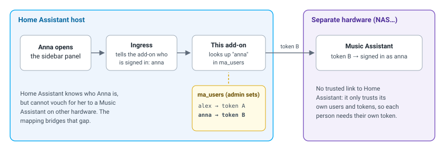
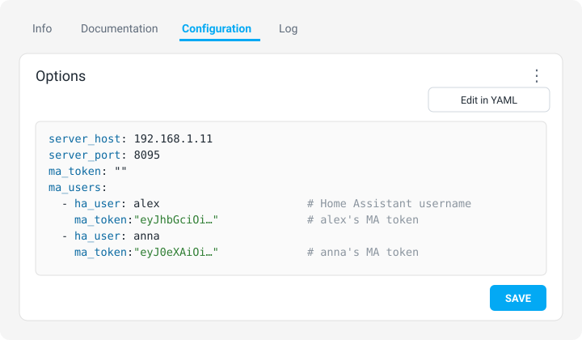

# Music Assistant Proxy


Music Assistant running on **its own hardware**, in your Home Assistant sidebar.

Music Assistant's own add-on runs the server on your Home Assistant machine. If you
would rather run it on dedicated hardware — a NAS, a mini PC, anything with the
headroom for library scans and transcoding — you lose the sidebar panel, because
Ingress only serves add-ons.

This add-on is an nginx reverse proxy that gives it back. It does **not** run Music
Assistant; it puts a server running elsewhere behind Home Assistant's Ingress, so the
panel appears in the sidebar and is reachable wherever Home Assistant is, without
exposing Music Assistant itself.

It also works around a quirk of the current Music Assistant release, which decides it
is running as an add-on purely from the URL and then refuses to show a login form.
[The add-on docs](DOCS.md) explain what is rewritten and why,
how signing in works, and what to expect when Music Assistant updates.

## Install

[](https://my.home-assistant.io/redirect/supervisor_add_addon_repository/?repository_url=https%3A%2F%2Fgithub.com%2Fshuricksumy%2Fhome-assistant-apps)

[](https://my.home-assistant.io/redirect/supervisor_addon/?addon=music_assistant_proxy&repository_url=https%3A%2F%2Fgithub.com%2Fshuricksumy%2Fhome-assistant-apps)

1. **Add repository** with the first button (or *Settings → Add-ons → Add-on Store
   → ⋮ → Repositories*).
2. **Open the add-on** with the second button, then *Install*.
3. Fill in the options below, *Start*, and enable *Show in sidebar*.

## Options

| Option | Default | What it is |
| :-- | :-- | :-- |
| `server_host` | `192.168.1.11` | Address of the Music Assistant server: an IP, a hostname, or a full URL such as `https://ma.example.com`. |
| `server_port` | `8095` | Port of the Music Assistant web interface (`443` for an HTTPS URL). |
| `ma_users` | _(empty)_ | **Per-user sign-in.** Home Assistant *username* (not display name) → that person's Music Assistant token. See below. |
| `ma_token` | _(empty)_ | **Shared token.** One token for everyone not in `ma_users`. Not recommended. |

## Several people, each with their own Music Assistant account

The panel shows for every Home Assistant user. There are two ways to sign people in to
Music Assistant:

- **Each person signs in once.** Nothing to configure. Each person opens the panel and
  signs in with their Music Assistant account. The session is kept per browser for 30
  days and renews while it is used.
- **Automatic sign-in per person.** Map each Home Assistant user to their own Music
  Assistant token, and nobody has to sign in. Set it up as below.

### Why the mapping is manual

When Music Assistant runs as an add-on on the Home Assistant machine, it trusts Home
Assistant to say who is signed in. That trust only works on Home Assistant's internal
network, so a Music Assistant on its own hardware cannot use it: it only trusts its own
users and tokens. Home Assistant does tell this add-on who opened the panel, so the add-on
can pass Music Assistant the right token. You tell it which token belongs to whom.



### Which username to use

Use the **Username**, not the **Display name**. Home Assistant tells the add-on who opened
the panel by username, so a display name never matches.

To see usernames:

1. Open your profile (your name, bottom left) and turn on **Advanced mode**.
2. Go to **Settings → People → Users**.
3. Copy the value from the **Username** column.

| Display name | Username | What to put in `ha_user` |
| :-- | :-- | :-- |
| Alex Smith | `alex` | `alex` |
| Anna Smith | `anna` | `anna` |
| Kid's tablet | — | nothing yet, see below |

Putting `Alex Smith` (the display name) in `ha_user` does not work.

**Username shows "—"?** That user has no login, so they cannot open the panel at all. Open
them under **Settings → People**, turn on **Allow person to login**, set a username and
password, and use that username.

Capital letters do not matter: `Alex` and `alex` are the same.

### Set it up

1. **Create a token for each person in Music Assistant.** Sign in to Music Assistant *as
   that person*, open the profile settings, create a **long-lived token**, and copy it.
   The token decides which Music Assistant account they land in, so it must come from
   their own account.
2. **Find each person's Home Assistant username,** as described above.
3. **Add them to the add-on.** Open **Settings → Add-ons → Music Assistant Proxy →
   Configuration**. Under **Per-user sign-in**, add one entry per person:
   - **Home Assistant username:** the username from step 2
   - **Music Assistant token:** the token from step 1

   Then **Save**. Only Home Assistant admins can open this tab, so nobody else can see the
   tokens.
4. **Restart the add-on** and open its **Log** tab. Each token is checked against Music
   Assistant:

   ```
   ma_users: alex: token accepted (Music Assistant user "alex")
   ma_users: anna: Music Assistant rejected the token (HTTP 401).
   ```

   A rejected token needs to be created again. The log cannot tell whether a *username* is
   right, so check those against the Users page.
5. **Test it.** Each person opens the Music Assistant panel and should land in their own
   account without signing in. If someone gets the login page instead, their username is
   misspelt or is a display name.

When a person is added or removed, or a token changes, edit the list and restart the
add-on.

Prefer YAML? Choose **⋮ → Edit in YAML** in the Configuration tab:

```yaml
ma_users:
  - ha_user: alex
    ma_token: "<alex's long-lived token>"
  - ha_user: anna
    ma_token: "<anna's long-lived token>"
```



### Shared token (not recommended)

The **Shared token** option (`ma_token`) signs everyone *not* in the list in as the one
Music Assistant user who owns it, and anyone it reaches can read it from the page source.
In a shared household, leave it empty. [The add-on docs](DOCS.md#auto-login) have the
details.

## License

MIT — see [LICENSE](../LICENSE).
